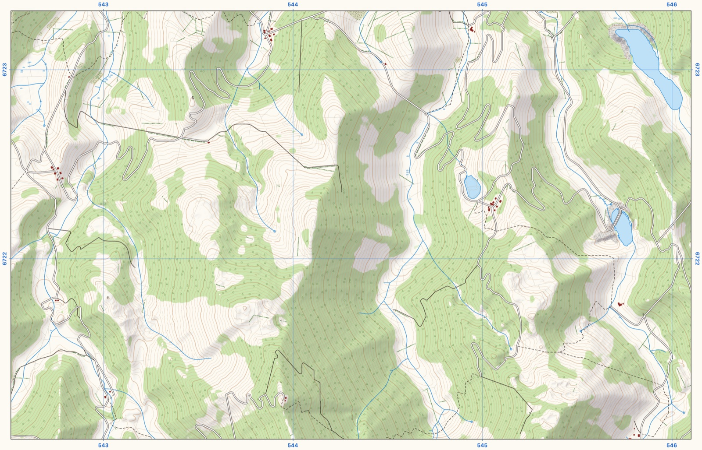
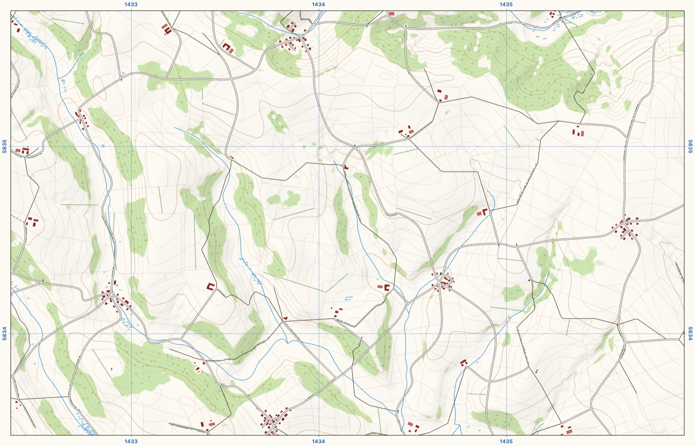
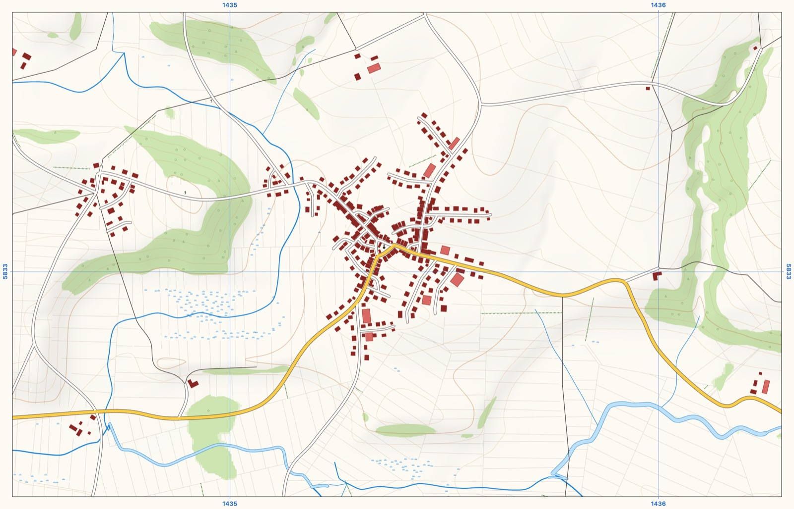
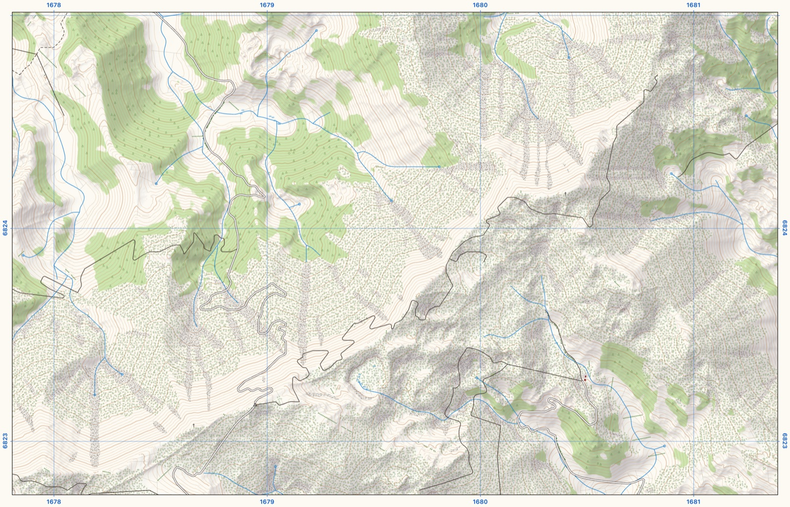

# Terra Incognita

**An endless topographic map that makes itself up as you go.**

Drag the map in any direction and new country appears: hills and valleys, rivers and lakes, woods, fields and hedges, villages with every house drawn, and the roads, tracks and footpaths between them. It's drawn at 1:10,000 in the style of the French IGN Top25 hiking maps.

There is no world behind it. Land that scrolls more than about 4 km out of view is forgotten, and if you go back, something different grows in its place.



## What you'll find

| | |
|---|---|
|  |  |
| **Lowland:** open farmland, scattered villages and farmsteads, and roads that join them up. | **A village up close (2× zoom):** streets, individual buildings, a main road, streams and marshes. |



**Alpine:** steep slopes drawn with rock and scree, 10 m contours, and roads that switchback up the valley sides.

The landscape changes character every 8–20 km, from lowland through hills and low mountains to alpine country. Rivers drain downhill into lakes, roads climb at gradients a car could manage, and settlements sit where people would put them. Everything you see was eroded, planned and drawn in your browser seconds before it scrolled into view.

## Try it

You'll need [Node.js](https://nodejs.org/).

```
npm install
npm run dev
```

Then open http://localhost:5173.

- **Pan:** drag, or use the arrow keys or WASD.
- **Zoom (0.5×–2×):** pinch, ctrl/⌘ + scroll wheel, trackpad pinch, or `+` and `-`.
- **Legend:** press `l`, or click the Legend tab in the right margin. It follows your browser's language (English, Dutch, French or German).

### URL parameters

Add these to the address to choose what you see:

| Parameter | What it does |
|---|---|
| `?seed=7` | Makes the land reproducible. Together with `?at`, the same address always shows the same place, which is handy for sharing one. |
| `?R=0.9` | Forces one kind of landscape everywhere: `0` is lowland, `1` is alpine. |
| `?at=x,y` | Starts at a position, in world metres. |
| `?z=2` | Starts at a zoom level between `0.5` and `2`. |
| `?legend` | Opens with the legend out. |
| `?lang=fr` | Sets the legend language (`en`, `nl`, `fr` or `de`). |

Without `?at` you start somewhere random. The village above is `?seed=7&R=0.1&at=735390,766960&z=2`, and the alpine valley is `?seed=7&R=0.95&at=979600,-223880`.

## How it works

The map is generated in 512 m chunks by a pool of Web Workers and drawn with Canvas2D, in TypeScript with no runtime dependencies. Each chunk goes through a series of stages: terrain, erosion and drainage, the road network, village street plans, a 4 m elevation model with land cover, and finally the rendered image.

There is no global seed. Terrain is gradient noise whose random values are created the first time some land needs them, and forgotten once no remaining land depends on them. Neighbouring chunks always agree exactly along their shared edges, but nothing is remembered once you leave.

The full design is in [SPEC.md](SPEC.md). Debugging parameters, the reproduction panel and the command-line dev tools are covered in [dev/README.md](dev/README.md).

## License

[MIT](LICENSE)
